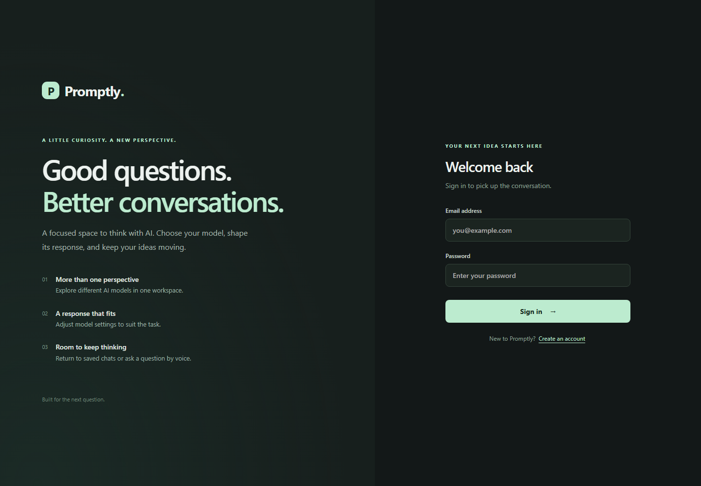
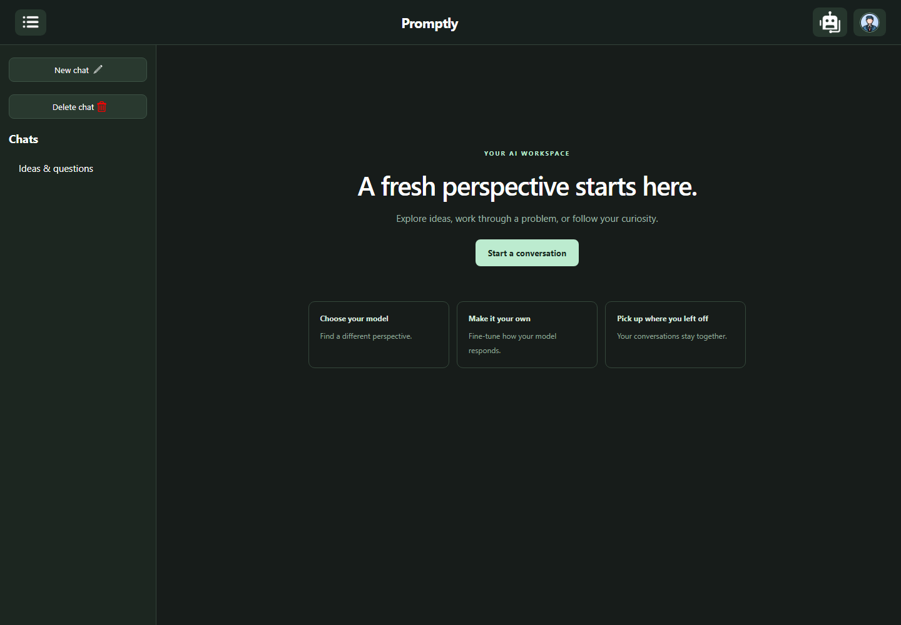
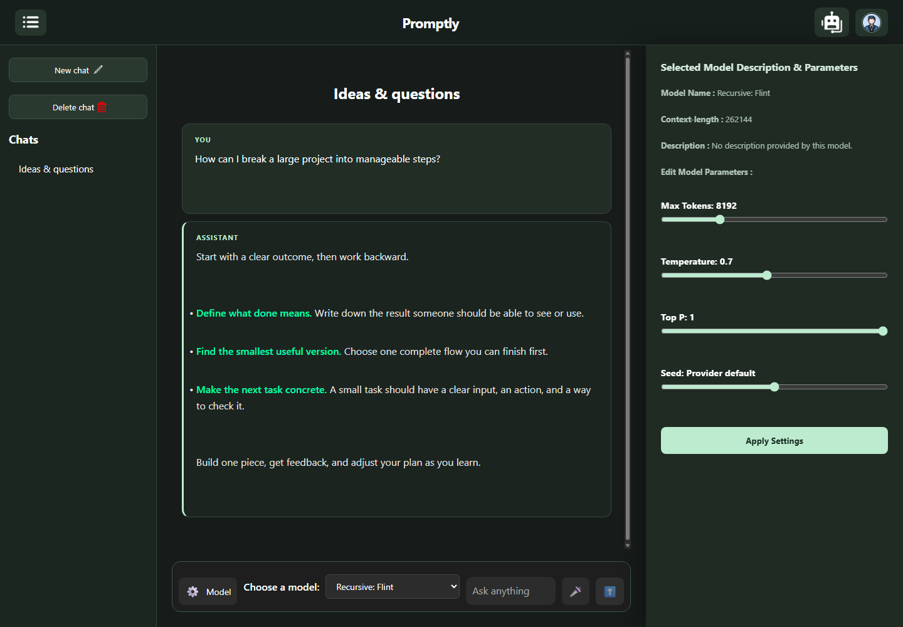
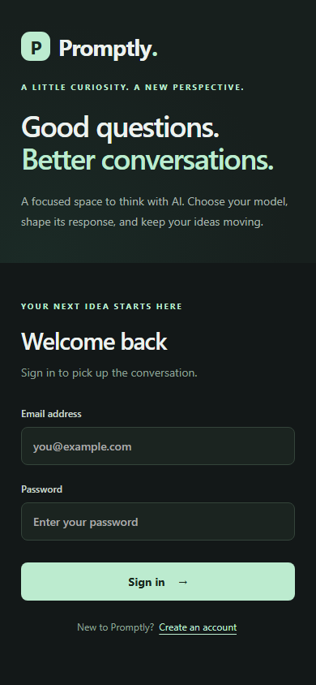
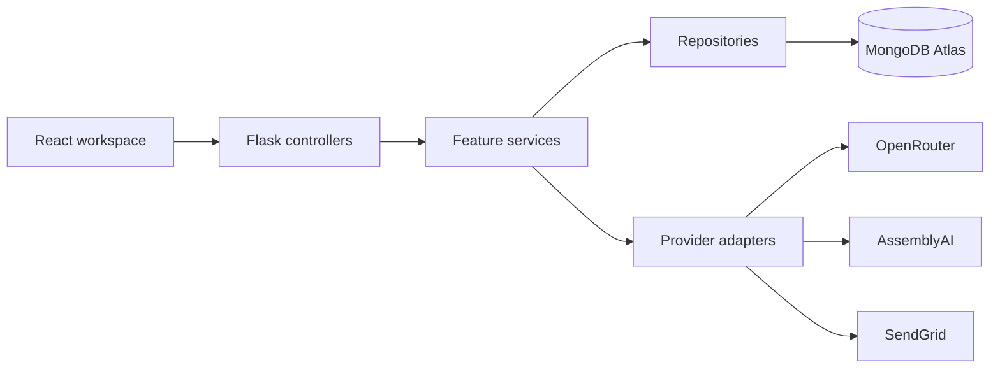

# Promptly

**A focused workspace for multi-model AI conversations.**

[](https://github.com/Omar-Ayadi-5/promptly-project/actions/workflows/ci.yml)


Promptly brings model selection, adjustable generation settings, saved conversations, and voice input into one React interface. A modular Flask API handles authentication, conversation storage, and external AI providers.



## What you can do

- **Explore different models.** Browse free models from OpenRouter and inspect their context limits and supported settings.
- **Control the response.** Adjust supported parameters such as temperature and output length. Draft settings are applied explicitly, and preferences stay separate for each model.
- **Keep the conversation going.** Create, revisit, and delete chats. Recent conversation history is included in subsequent AI requests.
- **Ask by voice.** Record a question, preview it, and send the transcription into the same conversation flow.
- **Manage your account.** Register with an expiring email code, sign in, change your password, and delete your account and associated conversations and recordings.

## A look inside



<details>
<summary>Model controls and mobile layout</summary>




</details>

Screenshots come from the running interface with deterministic browser-test API fixtures; they do not contain real account data or provider responses.

## Architecture

The original React + Flask architecture and directory layout are retained. Backend features have controllers, services, repositories, and provider adapters, with only the layers each feature needs.

```text
src/assets/
  frontend/                 React components, hooks, styles, and Vite config
  backend/
    main.py                 Development and WSGI entry point
    app/
      common/               Authentication, validation, and request errors
      infrastructure/       MongoDB, OpenRouter, AssemblyAI, and SendGrid
      modules/
        auth/               Registration, codes, sign-in, and rate limits
        users/              Account and password operations
        chats/              Conversations and message persistence
        generation/         AI request orchestration and validation
        catalog/            Model metadata and refresh
        voice/              Recordings and transcription
        health/             HTTP health endpoint
  model_parameters.json     Shared parameter definitions
tests/                     HTTP, security, provider payload, and browser tests
```



### Engineering decisions

- **Dependency injection at the app factory:** tests replace databases, mail, transcription, and AI providers without network requests or writes to a real database.
- **Capabilities drive generation controls:** the browser and backend filter parameters against stored model metadata using the shared definition file. Unsupported settings are excluded before calling the provider.
- **Provider failures remain failures:** rate-limit and provider errors reach the interface; failed replies are not saved as successful assistant messages.
- **Account rules live on the server:** signup consumes a hashed, expiring verification code atomically. JWTs expire after one hour, and authentication attempts use shared MongoDB counters.

## Run locally

Use **Node.js 22.12+**, **Python 3.12+**, and a **MongoDB Atlas** database. OpenRouter is required for AI replies. SendGrid is required for registration email; AssemblyAI is required for voice transcription. You will need your own provider credentials.

Clone this repository and run the following commands from its root:

```powershell
git clone https://github.com/Omar-Ayadi-5/promptly-project.git
cd promptly-project
```

### 1. Backend

```powershell
cd src/assets/backend
python -m venv .venv
.\.venv\Scripts\python.exe -m pip install -r requirements.txt
Copy-Item .env.example .env
```

On macOS/Linux, use `python3 -m venv .venv`, `.venv/bin/python` in place of the Windows interpreter path, and `cp .env.example .env`.

Fill in `.env` before starting the API. Generate independent signing and admin secrets with:

```powershell
.\.venv\Scripts\python.exe -c "import secrets; print(secrets.token_urlsafe(48))"
```

| Variable | Purpose |
| --- | --- |
| `MONGO_URI` | MongoDB Atlas connection URI; allow your IP in Atlas network access |
| `openrouter_key` | Server-side OpenRouter API key |
| `Token_secret_key` | Random JWT signing secret, at least 32 bytes |
| `ADMIN_SECRET_KEY` | Separate random secret for catalog refresh |
| `SENDGRID_API_KEY` | SendGrid API key |
| `SENDGRID_FROM_EMAIL` | A verified SendGrid sender address |
| `asembly_ai_key` | AssemblyAI key; spelling retained for compatibility |
| `CORS_ORIGINS` | Comma-separated browser origins; defaults to local Vite dev/preview origins |

```powershell
.\.venv\Scripts\python.exe main.py
```

The API runs at `http://localhost:5000`. `GET /api/server_health` checks the HTTP server, not provider or database availability.

### 2. Populate the model catalog

With the backend running, use another PowerShell terminal:

```powershell
$promptlyAdminKey = Read-Host 'Admin secret'
Invoke-RestMethod -Uri http://localhost:5000/update_models -Headers @{ 'X-Admin-Key' = $promptlyAdminKey }
Remove-Variable promptlyAdminKey
```

The secret is sent in a header. Query-string credentials are rejected.

### 3. Frontend

In another terminal, from the repository root:

```powershell
cd src/assets/frontend
npm ci
npm run dev
```

Open `http://localhost:5173`, create an account, and enter the email verification code. Development API requests default to port 5000. To override the backend address, copy the frontend `.env.example` to `.env.local` and set `VITE_API_BASE_URL`.

## Validation

Backend tests run without real credentials, network calls, or a database. From the repository root, after installing backend dependencies:

```powershell
.\src\assets\backend\.venv\Scripts\python.exe -B -m unittest discover -s tests -p 'test_*.py'
python scripts/check_secrets.py
```

Frontend checks:

```powershell
cd src/assets/frontend
npm run lint -- --max-warnings 0
npm test
npm run build
npm audit
```

For browser integration tests, leave Vite running on port 5173 and run `npm run test:browser` in another terminal. The script uses Chrome or Edge on Windows, or Chrome/Chromium on Linux. Set `CHROME_PATH` when automatic discovery does not find the browser. API requests and microphone recording are mocked; this checks application behavior without contacting providers. It covers model controls, text and voice requests, rate-limit feedback, and mobile overflow.

CI installs locked dependencies and runs the backend suite, source secret checks, frontend lint/tests/build, and browser integration checks on every push and pull request.

## Deployment and current scope

- Run the API with `gunicorn main:app` from `src/assets/backend`. Use HTTPS and set environment variables through your host's secret manager. The development server is for local use.
- Build the frontend with `npm ci && npm run build` from `src/assets/frontend`. Set `VITE_API_BASE_URL` before building when the API is hosted separately; an unset production value uses the same origin. Configure your static host to rewrite browser routes such as `/app` to `/index.html`.
- Set `CORS_ORIGINS` to the exact deployed frontend origin. Never put provider keys in Vite variables; frontend configuration is public.
- Startup creates unique email indexes and expiring verification/rate-limit indexes. Use a clean database for a fresh deployment. Existing datasets must have duplicate emails resolved before enabling these indexes; legacy plaintext verification records are not accepted.
- Login sessions expire after one hour. There is no refresh-token flow or immediate revocation of already-issued JWTs on password change or account deletion. Clear sessions by rotating the signing secret when needed.
- Model availability and free-provider quotas can change. Signup depends on a verified SendGrid sender. Voice uploads are limited to 10 MB; transcripts and recordings are stored in MongoDB. Account deletion removes recordings associated with that account; a retention policy for old recordings is future work.
- Authentication uses per-IP fixed-window limits backed by MongoDB. Configure trusted proxy handling deliberately for your host; forwarded IP headers are not trusted by default. Provider quotas and deployment-level request limits still need operational configuration.

See [backend documentation](src/assets/backend/README.md) for module responsibilities and [security guidance](SECURITY.md) for reporting and credential handling.
